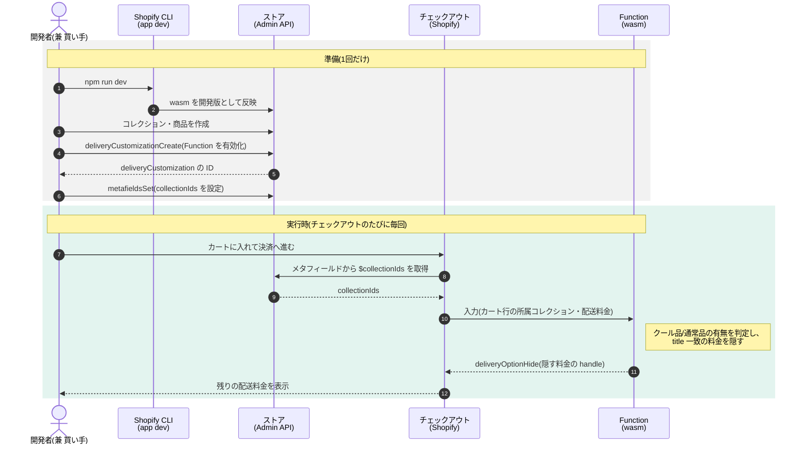
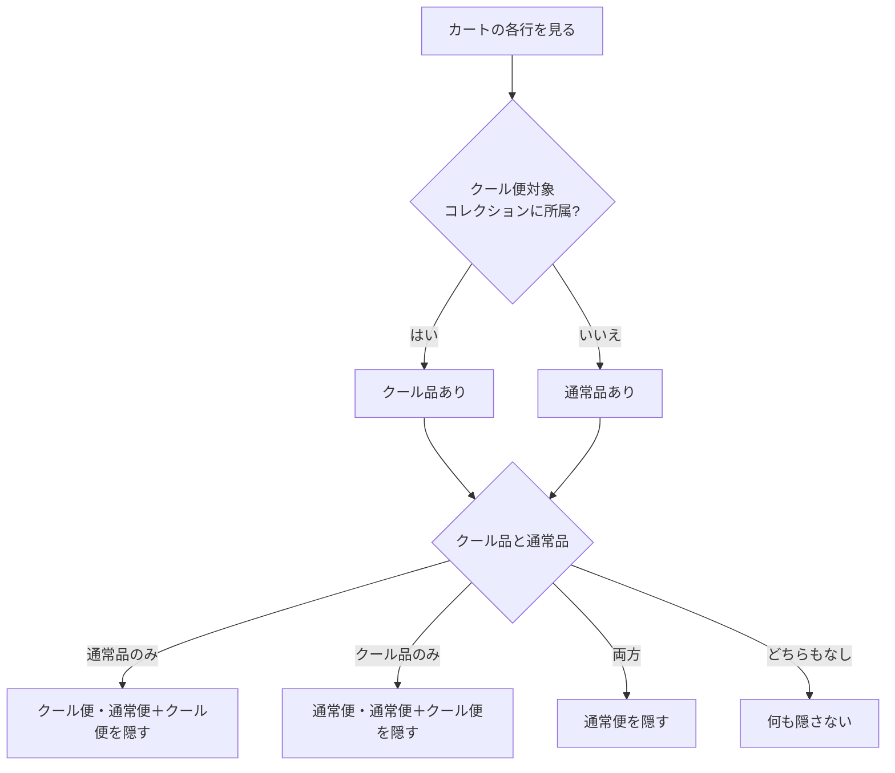

# delivery-cool-split の処理の流れ(シーケンス図)

[delivery-cool-split](./delivery-cool-split.md) の、準備から配送オプションが絞られて表示されるまでの流れです。

## 各ステップの補足

| # | 内容 |
| --- | --- |
| 1-2 | `shopify app dev` が Function をビルドし、開発ストアに開発版として反映する。`deploy` は使わない |
| 3 | 「クール便対象」コレクションと、クール品・通常品のテスト商品を作る |
| 4-5 | `functionHandle: "delivery-cool-split"` で有効化する。このとき deliveryCustomization が作られる |
| 6 | deliveryCustomization の `$app:delivery-cool-split` / `variables` に `{"collectionIds": [...]}` を設定する。ショップやアプリ設置ではなく、deliveryCustomization 自体に付ける |
| 7-9 | チェックアウトが 6 の値を読み、入力クエリの変数 `$collectionIds` に埋めてから Function を呼ぶ |
| 10 | 判定ルールは [delivery-cool-split.md](./delivery-cool-split.md) の「2. 仕様」を参照 |
| 11-12 | Function は隠す料金を返すだけで、残った料金はそのまま表示される |

## 判定の流れ(Function の中)

